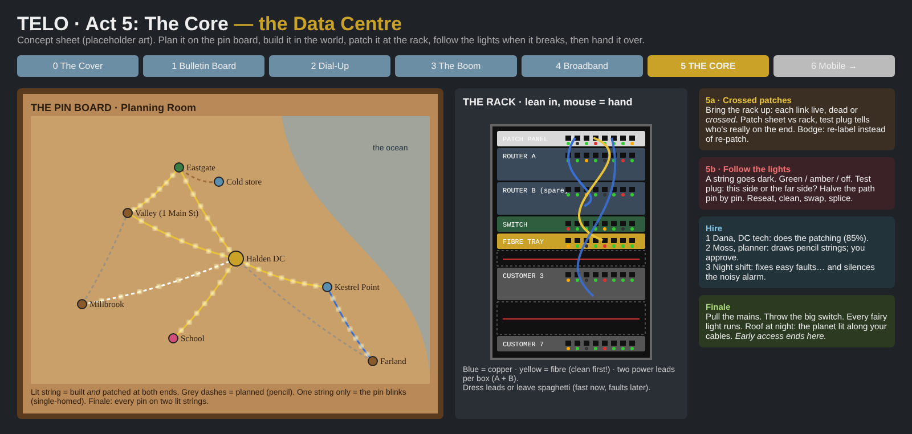

# The Data Centre: how early access ends

*Idea session, 2026-11-21. Owner's brief: "a data centre building that we connect into for the end of the early access. Mobiles should be later. A ton of gameplay of real telco activities: setting things up and connecting different sections together in an easy network rack, but you have to plug in the network and build out the network infrastructure topology, then a tiny network fiddling game, then hire someone." Then: "go crazy".*

*Owner's choices: a **new Act 5, The Core**, which ends early access in the data centre (mobile moves to Act 6). **Lay the map out yourself** on a pin board. **Both** fiddling games: crossed patches when you build, follow the lights when something breaks. Decisions D46–D50. Everything else here (names, numbers, rooms, jokes) is Claude's first draft: change freely.*

---

## 0. The idea in one paragraph

By the end of Act 4 your network is a mess, and you built the mess yourself. The valley runs off the modem bank behind 1 Main Street, Eastgate off a street cabinet, hosting sits in a fish cold store, Millbrook hangs off one microwave hop, and Farland hangs off one ocean cable. Each part was built in a hurry, for a reason, and none of them know about the others. **Act 5 is where you tidy up.** You build one proper building on Halden Flats, the plain where your cables already cross. Then you bring every part of the network into it, one at a time, and run each part home by hand. You plan on a cork board with pins and string, build the links for real, and patch them in at a rack where you can see every cable. You find out what you got wrong by following the lights. When it is all in and you can trust it, you hire the people who will do it for you. The last thing in early access is the night every pin on the board lights up at once.

This fits the game's core idea: **the job changes as you play.** In Act 0 you wire a frame in a rented room. In Act 5 you wire a building that the whole planet runs through, and at the end you are approving someone else's pencil lines on the board instead of drawing your own.

---

## 1. Act 5: The Core (2007–10)

| | |
|---|---|
| **Id** | `act5-core` (new). Mobile keeps its id `act5-mobile` and becomes index 6 (ids are labels, never renamed). Platform → 7, Intelligent → 8. |
| **Business model** | Colocation, hosting, transit, cross-connects: you sell space, power and a cable to anyone else in the building |
| **What holds you back** | Ports, power and heat, and your own spaghetti |
| **Signature minigames** | The rack (§4), crossed patches (§5a), follow the lights (§5b) |
| **Gate** | `ann-core` "Everything goes through a building now": the 2006 papers are full of server farms. Almanac page `alm-core` (Act 4, readable) opens it early |
| **Act ends when** | `proj-dc-lit` is done: every pin on the board is lit, dual-homed, and patched to the core |
| **Exit text** | "Every light on the board is on. For one night, nothing is broken. In the car park, a man from a phone shop is handing out leaflets for a phone with no buttons." (the hook into Act 6, mobile) |
| **Target** | 4–5 real hours (D42) |

**Why here and not mobile:** the data centre pays off everything built so far. It is the most hands-on telco work in the game: racks, patching, splicing, power and change windows. It is also the biggest money sink, which EA1 says the game needs ("money still piles up after Act 5").

---

## 2. The place: Halden Flats

- **A new `Site` in `PlanetGen`:** a wide, flat, slightly boring plain at the middle of the triangle valley, Eastgate and Kestrel Point. It's boring on purpose: no flooding, no neighbours, cheap land, and every road and cable you have already passes near it. Comedy: the council is delighted that anyone wants it.
- **The building is built in stages, as projects** (§6), and grows on the site as you play:
  1. A concrete slab with a portacabin on it (your office for the first half of the act).
  2. A steel shell with a roller door.
  3. Inside, five rooms you can walk into, each a place where you do something.

| Room | What you do there | World tell (D: every task has a prop that shows its backlog) |
|---|---|---|
| **The Planning Room** | The pin board (§3). Work orders get printed here | Pinned work orders on a clip rail; red pins for what's down |
| **The Meet-Me Room** | Where every outside cable comes in. A wall of fibre trays (the ODF). Splicing, cross-connects | Cable ends hanging out of the floor ducts, labelled with luggage tags |
| **The Hall** | Rows of racks: yours (the core) and customers' cages. Cold aisle / hot aisle | Empty rack slots with tape across them; blinking amber lights |
| **The Plant Room** | Power: grid feed, batteries (UPS), the generator, the A/B switchboards. Cooling units | The load needle on the big dial; the generator's log book |
| **Loading bay** | Kit arrives from the Yard (D43); customers wheel their servers in | Crates on pallets with delivery notes |

- **The roof:** a ladder, the cooling fans, and a view. This is where the finale is watched (§7).

---

## 3. The pin board: lay the network out yourself (D47)

A big cork board in the Planning Room with a hand-drawn map of everything you own on the planet. You lean in, the same way you lean into the switchboard (D26), and the mouse is your hand.

### What's on it
- **Pins = sites.** Every building with your equipment in it gets a pin: the exchange at 1 Main Street, the Eastgate cabinet, the cold store, Kestrel Point, the Millbrook hut, the Farland exchanges, and the new data centre (a big brass pin in the middle). Pins appear as projects are built. A pin's colour shows its kind: copper exchange, cabinet, landing, hosting.
- **String = links.** Each link you've built in Acts 0–4 is already pinned in as a string, in the colour of what it is: brown for copper, white for microwave (drawn as a dotted chalk line, because it goes through the air), yellow for fibre, and blue for the ocean cable.
- **Fairy lights.** Each string has small bulbs threaded along it (the joke: the planner's daughter's Christmas lights). **A string glows when its link is actually carrying traffic**, meaning it is built in the field *and* patched in at the racks at both ends (§4). A dark string on the board means something is wrong in the world. This is the game's first real network view, and it is an object, not a dashboard (the Sight branch still earns the real dashboards in Act 6).

### What you do with it
1. **Plan.** Take a reel of string off the hook and run it from one pin to another. Choose the kind of link (the reels: copper, fibre, microwave). The board prints a **work order** on the clip rail: the route, the parts to buy at the Yard, the cost, and the days of crew time. Planned string is drawn in pencil grey until it's built.
2. **Build.** A work order is a project like today's (`projects.json`), done step by step at the real places: dig, run, splice, raise a dish. When the field work is done the string turns from grey to its colour, still dark.
3. **Patch.** At the rack in each site (§4), plug the new link into a router port. When both ends are patched and powered, the lights on the string come on.

### The rules of the board (pure sim, `Net/TopologyRules.cs`)
- **Single-homed sites blink.** A pin with only one lit string blinks slowly: if that string is cut, the site goes dark. Act 5's finale needs **every pin on at least two lit strings** (dual-homed), which means a ring or a mesh, not a star. This is the real lesson of the act, and players see it on the board without being told.
- **Capacity.** Each string carries so many subscribers (copper < microwave < fibre < ocean). A string at its limit sags and its bulbs flicker in the evening peak, the same Board/lines-in pattern from Act 0, one level up (CLAUDE.md: "This is the pattern for every later bottleneck").
- **Distance and terrain.** Fibre costs by length; microwave needs line of sight (reuse D44's hill check when masts come); the ocean only takes cable.
- **No magic.** A string you plan but never build stays grey for ever. A string you build but don't patch stays dark. The board never lies about the world.

### Cable cuts and other surprises (events, no crime)
- A farmer's plough, a digger working for NezTel (AGES Act 4 already has "Digger hits a Nez cable", turned the other way round), a storm on the microwave, a ship's anchor on the ocean cable. That string goes dark. If its pins were dual-homed, traffic goes round the other way and the only cost is time. If not, a town is offline until you fix it. This is how the game teaches you to plan rings.

---

## 4. The rack (D48)

A lean-in station like `SwitchboardStation`: you stand in front of a real 42-unit rack, the mouse is your hand, and the kit is on a trolley beside you. It is **easy on purpose**. There are five kinds of box, three colours of cable, and every port is labelled in plain words ("TO MILLBROOK", "CUSTOMER 3", "POWER A"). There is no configuration text, no addresses and no commands (CLAUDE.md: crime and tech stay abstract).

### The boxes (bought at the Yard, carried on the trolley)
| Box | Height | What it does in the game |
|---|---|---|
| **Patch panel** | 1U | Where outside cables land. A row of labelled sockets. Never changes once you've wired it |
| **Router** | 2U | One port per string on the pin board. A link is "up" when it's patched from the panel to a router port |
| **Switch** | 1U | Ports for customers and servers in this building |
| **Fibre tray** | 1U | Fibre version of a patch panel; needs **clean** before **connect** (§5b) |
| **Power strip (PDU), A and B** | 0U (on the sides) | Every box has two power leads. Plug one into A and one into B, or it goes down when you test the generator |

### The verbs (the eight-verb rule, D31)
- **carry:** take a box from the trolley.
- **fasten:** slide it in and do up four screws (four clicks; staff skip a screw sometimes, so a box "sags" until someone reseats it).
- **connect:** take a patch lead (blue = copper, yellow = fibre, red/black = power) and click port to port. The lead is drawn as a real curved mesh, as on the switchboard.
- **test:** the test plug (a loopback) in a port: green if this end is fine.
- **clean:** the fibre pen on a fibre end before you plug it in.
- **remove:** pull a lead or a box.
- Run, climb: not at the rack (they're field verbs).

### Tidy versus spaghetti (the chaos option)
- Each patch lead can be **dressed** (one more click: route it through the cable arms at the side, and the right length is picked automatically) or **just plugged** (straight across the front, the wrong length, draped).
- A rack with lots of undressed leads becomes **spaghetti**. It works today. But every later visit risks knocking a lead loose (a latent defect), the rack runs hot (heat in the Hall), and the crossed-patches game (§5a) gets harder because you can't follow a lead by eye. You can see this: spaghetti racks look like spaghetti. Failure costs time, never progress.

### Racks at every site, not just the data centre
Each pin on the board has a small rack (a 6U wall box in a cabinet, 12U in the exchange hut, the full 42U in the Hall). **Patching a link in means visiting both ends.** That's the travel and the "ton of gameplay": drive to Millbrook, patch the microwave into their router, drive back, patch it at the core, and watch the string light. Staff take this over later (§6).

**Retrofit, a gift to EA2f (Acts 1–2 ask for more):** the existing "Rack the modem bank" (Act 2) and "Rack the servers" (cold store, Act 3) steps become short sessions at a small rack, using this station, instead of clicks on a box. The rack is first met in Act 2 with three boxes, then grows. That adds real, hands-on hours to the acts that are too short today.

---

## 5. Two fiddling games (D49)

Both are pure sim minigames that follow the CLAUDE.md recipe: `Generate(seed)`, the player verbs, `Evaluate()`, `Delegate(seed, accuracy)`, a soft clock, and no fail screen.

### 5a. Crossed patches (when something is built)
*When a rack is first brought up, the lights tell you what went wrong in the wiring.*

- When you (or a crew) finish patching a rack, you **Bring It Up**: a big switch on the PDU, the cousin of `Simulation.ThrowSwitch`. Every link comes up **live**, **dead** or **crossed**.
- **Crossed** means a lead went into the wrong port: the router thinks the cable from Millbrook is the one from Eastgate. On the board, *Eastgate's* string lights but *Millbrook's* customers can't get through. On the rack, the port label says EASTGATE and the lamp blinks the slow two-tone "I'm hearing somebody else".
- **The puzzle:** a printed patch sheet (what should go where) against the rack in front of you. Using **test** on a port tells you who is actually on the other end (the tone probe from the switchboard, grown up). Swap the leads until everything matches. The mistakes come from the generator: crew mistakes (85% accuracy), leads that came pre-cabled from the Yard ("factory-patched, mostly"), and the labels on the cold store's old leads, which are wrong (the smudged tags of Act 0, again).
- **Soft clock:** each minute a link is crossed, two towns get wrong numbers. They grumble, and there's no fail screen.
- **Chaos option:** **re-label** instead of re-patch. Write the new name on the port to match what's plugged in. It's done in seconds, and the next person to read that rack is lied to (a latent defect that surfaces as a hard 5b fault later).
- **Size:** 4–12 leads. It gets bigger with the rack, never harder in rules.

### 5b. Follow the lights (when something breaks)
*A string on the board has gone dark. Find out where and why, with lights and a test plug.*

- **It starts** as a ticket on the clip rail: "Millbrook can't get through", a red pin, and the pager beeps (Attention). The board shows which string is dark, but **not where along it the fault is**. That's the game.
- **The walk:** stand at the rack at one end. Every port lamp tells you something:
  - steady green: fine;
  - amber flicker: errors (dirty fibre, damaged lead);
  - off: nothing arriving.
- **The test plug** in a port answers one question: "is it this side or the far side?" Loopback green means this end is fine, so the fault is further out. You walk (or drive) the path pin by pin, halving where it could be. It's the real method engineers use, and it's simple to play.
- **Causes** (the sim picks one, seeded; each has a tell and a fix using the eight verbs):

| Cause | Tell | Fix | Bodge (works today, defect later) |
|---|---|---|---|
| Loose lead | Off; the lead sits proud of the port | **Reseat** (push it home, as on the switchboard) | Tape it in place |
| Dirty fibre | Amber flicker | **Clean** with the fibre pen, reconnect | Blow on it |
| Bad lead | Amber, and still amber after cleaning | **Swap** with a spare from the drawer | Swap with one that's "probably fine" from the bin |
| Crossed patch (someone's "tidy-up") | The two-tone lamp | Re-patch (a mini 5a) | Re-label |
| Dead module | Off; the test plug fails *in* the box | **Remove** it and fit a new one from the Yard ($) | Borrow one from a customer's switch (their line dies next week) |
| Single-fed power | The box is dark after the Sunday generator test | Plug the B lead in | none: this is the lesson |
| Cut in the field | Every rack lamp is green but the far end hears nothing | Drive out, find the break (marked by a digger, a broken pole, a ship), **splice** (3-click hold) | A temporary joint in a bin bag (it fails in the rain) |

- **Soft clock:** subscribers on the dark string lose satisfaction by the hour. A dual-homed site loses almost none, which is the reward for planning well (§3).
- **You can't see past the break.** Until the NOC (§6) and the Act 6 Sight branch, nothing tells you remotely what's wrong. You go and look. Later the job changes: you'll get the answer on a screen, and you'll miss the walk.

**Which comes when:** 5a every time a rack is brought up, or re-brought up after a change. 5b whenever a fault, cut or latent defect surfaces on a link. From mid-Act 5 there are one or two 5b tickets a week. That's the regular "keep" job of the five-job loop (EXPANSION_DESIGN).

---

## 6. The act, project by project (D42: named builds)

Each is a `projects.json` entry with steps, parts from the Yard (D43), waits, and a reward. The ids are new and stable. Costs are first guesses, set to soak up the Act 4 cash pile (D41 bands to be re-tuned).

| # | Project | Where | What you do (steps) | Reward / unlocks |
|---|---|---|---|---|
| 1 | `proj-dc-slab` **Pour the slab on Halden Flats** | Halden | Buy the land at the council (they're thrilled), lay the shuttering, pour; wait 5 days | Portacabin office, the pin board moves in (your planning starts here) |
| 2 | `proj-dc-shell` **Raise the hall** | Halden | Steel frame (crane from the Yard), cladding, roller door; wait 7 days | The building. Rooms exist but are empty |
| 3 | `proj-dc-power` **Power: grid, batteries, generator** | Plant Room | Grid feed from the substation, a battery string (carry ×6), the generator, then **pull the mains on purpose** (the Sunday test, now a ritual) | A and B power in the Hall. The **load dial** starts mattering: each box draws power, cooling draws more |
| 4 | `proj-dc-cooling` **Cold aisle** | Hall | Cooling units, floor tiles, face the racks the right way (cold in front, hot behind: a placement rule; one rack placed backwards runs hot) | Racks can go in. Heat becomes a number |
| 5 | `proj-dc-meetme` **The Meet-Me Room** | Meet-Me Room | Fibre trays on the wall, ducts from outside, label every tray | Outside cables can come in. Cross-connects (§8) can be sold |
| 6 | `proj-dc-core` **The core rack** | Hall | Your first full rack at the station (§4): two routers (one is the spare), switches, patch panels, A+B power. Bring it up (5a) | The big brass pin on the board lights. The rest of the act is homing |
| 7 | `proj-home-valley` **Bring the valley home** | 1 Main St → Halden | String on the board, dig fibre from the old exchange to Halden, patch both ends | The valley's string lights. Your first room's modem bank is now a "remote site" |
| 8 | `proj-home-eastgate` **Bring Eastgate home** | Eastgate cabinet → Halden | Same, plus a second string to the valley (the first ring!) | First dual-homed pins stop blinking |
| 9 | `proj-migration` **Migration night** (flagship, "only you") | Cold store → Halden | Move every hosting customer's server from the fish store to the Hall in one night, 01:00–05:00, before Sol opens his shop and finds his web page down. Carry, fasten, connect, bring up, and check each customer's light. Soft clock; late servers mean grumpy customers, not failure | The cold store goes back to fish. Hosting revenue moves; there's room to sell colo (§8) |
| 10 | `proj-home-millbrook` **Bring Millbrook home** | Millbrook → Halden | Microwave hop to Halden plus fibre back to the valley (a ring) | |
| 11 | `proj-home-farland` **Bring Farland home** | Kestrel Point → Halden | Fibre from the landing station to the Meet-Me Room. **The ocean cable is still single**: you plan a second landing or lease capacity on NezTel's old cable (a deal with Nez at Nadir: pride against resilience) | |
| 12 | `proj-peering` **Shake hands with NezTel** (optional) | Meet-Me Room | One cross-connect to NezTel's cage. Patch a lead between your rack and theirs, and shake hands with Nez's engineer, who is nicer than Nez | Cheaper traffic; Nez now knows exactly what's in your building |
| 13 | `proj-dc-lit` **Light the board** (finale) | Planning Room | Every pin on two lit strings, every rack brought up with no crossed patches, the generator test passed with nothing going dark. Then flip the big switch on the board | **Early access ends** (§7) |

The old mast projects (`proj-first-mast`, `proj-cell-sites`, `proj-backhaul`) keep their ids and move to Act 6. Their `requiresProjects` points at `proj-dc-lit`. Backhaul to masts becomes "more strings on the board", which the board already knows how to draw.

---

## 7. The finale: lighting the board

The last thing early access asks you to do. It should feel earned and a bit magical.

1. You've met the conditions: every pin dual-homed and lit. PIP says, "Everyone's here."
2. The **Sunday generator test, live:** PIP suggests one last check. You pull the mains. The Hall goes quiet for two seconds, the batteries take it, and the generator coughs and catches. Any box with only one power lead goes dark, and you fix it. (Players who've been careful get a clean pass and a line from PIP.)
3. You walk up to the board and **throw the big switch** on its frame (it does nothing electrically; Jory wired it up for the occasion). All the fairy lights run along their strings one after another, the way a planet's network would light up seen from above.
4. **Climb to the roof.** It's night. Out on the planet, the towns you connected are lit, and along the roads and the coast your cable routes glow faintly (a planet-wide overlay, shown only in this scene). Up close it's the town; from the roof it's the planet.
5. The exit text (§1) plays: the man in the car park with the button-less phone. A card reads: **"Early access ends here. Act 6: the phone in everyone's pocket. Your network keeps running: carry on."** The save carries on. The game doesn't stop: you can keep running the building, selling colo and fixing faults.

---

## 8. The money, and the gameplay that fills the hours

Building the act is maybe 2–3 hours. The **keep and sell** work in between is what makes Act 5 feel full:

- **Colocation:** customers rent a slot or a whole rack in the Hall. They come in through the loading bay with their own servers. Installing them means carry, fasten, A+B power, and a lead to your switch. It's the bench-job mechanic with a new place (AGES Act 3 already lists "Install a colo customer's rack").
- **Cross-connects:** two customers in your building want a cable between them. It's ten seconds of patching in the Meet-Me Room for $30 a month for ever, and it is **the best money in the game**, which is true of real data centres too.
- **Remote hands tickets:** comic, quick filler jobs from customers who are far away. "Please press the reset button on the grey box in rack 4", "Is the light green? Which green?", "Plug the thing back in that my intern unplugged". These are the odd jobs of Act 5 (the same pattern as Act 0's odd jobs: cash and goodwill, `[R]` to rush).
- **Power and heat:** every box draws power; the load dial in the Plant Room fills up. Sell too much colo and you need a second generator (a project). Racks placed hot-side-to-cold-side run hot and raise the fault rate. Each fix creates a new problem: more power costs a monthly bill.
- **Last Mile** (named people): the island school from AGES Act 3 asks for a free rack slot for their library server. Say yes and they're on the board as a tiny pin with a fairy light of their own.
- **Borrowed Light** (folk comedy): a customer's rack hums suspiciously and is very popular at night. You don't look inside. Your call: leave it (the money is good) or knock (the customer moves to NezTel).
- **Monthly bills:** power, rates, insurance. They're large on purpose, and D41's Act 5 band soaks up the Act 4 surplus.

---

## 9. Hire someone: the hand-off ladder for the Data Centre (D50)

Each stage is a `work.json` hire, earned by doing the job yourself first. Each makes the job easier and creates a new problem (CLAUDE.md rule).

| Stage | Who | Earned by | What they do | New problem |
|---|---|---|---|---|
| 1 | **Dana Wilke, DC technician** ($ wage, depot rules) | Bringing up the core rack yourself (`proj-dc-core`) | Takes work orders off the clip rail: patches racks, installs colo, does remote-hands tickets. 85% right | Their crossed patches and skipped screws are latent: 5a and 5b games come from their work, not just yours. Also, they dress *every* lead beautifully and slowly |
| 2 | **Moss Achebe, network planner** | Homing three sites by hand | Draws **pencil strings** on the board for the next links. You only **approve** (pin a green tag on it) or **scrap** them. The job has changed: you approve now instead of drawing | Moss plans the cheapest route, not the most resilient. A string that looks fine on the board shares a duct with another one, and one digger takes out both ("they were both under the same road, boss") |
| 3 | **The night shift (NOC)**, two people at a desk with a bank of lamps | Fixing five 5b faults yourself | Watches the board overnight. Does 5b for the easy causes (loose lead, dirty fibre, swap a lead) and pages you for the hard ones (field cuts, dead modules) | They silence the alarm that goes off every night. One night it's a real fault, and nobody finds out until the morning (AGES Act 3, "They silence the noisy alarm", now playable) |

The hiring itself works the D25 way: you hand Dana her first work order in person at the Planning Room door. Once they are hired, the Hall runs while you sleep, and the bed's `RestUntilNeeded` skips ahead faster. The calendar speeds up the more you hand over, as the game intends.

---

## 10. How it fits what's already built

| Already built | How the Data Centre uses it |
|---|---|
| Projects (`ProjectRules`, `projects.json`) | Every build in §6 is a project; homing projects get a link and two rack visits |
| The switchboard station (D26) | The rack station is its cousin: lean in, the mouse is your hand, leads are meshes, lamps show state |
| `ThrowSwitch` (live/dead/crossed) | Bring It Up (§5a) uses the same three outcomes |
| Tone probe, reseat, smudged tags | Test plug, reseat, wrong labels in 5a and 5b |
| The Board / lines in, line cards | String capacity and the evening sag (§3) |
| The Yard (D43) | Every box, lead, reel and battery is bought there; the truck carries the big ones |
| Staff tickets in person (D25) | Work orders on the clip rail, handed to Dana |
| Latent defects, faults, `!` markers | Every bodge in §4–5 is a latent defect; surfaced ones become 5b tickets |
| Regions (Millbrook, Farland) | Each region is a pin; homing it doesn't change its subscribers, but a dark string stops their bills (and satisfaction) |
| Nez (spine) | Nez's cage in your Meet-Me Room (§6 #12); Nez's engineers dig; Nez offers to "manage" your building for you (the Act 6 temptation) |
| The script player | Must play Act 5 end to end. The bot needs `Actions.For` entries for the board, the rack and both fiddling games |

---

## 11. What this is not (to keep it buildable)

- **No real networking.** No addresses, protocols, commands or config screens. Ports have plain names; a link is up or not; a cable is copper, fibre, microwave or ocean.
- **No dashboards.** The board is a physical object; the lights are bulbs. Screens arrive with the Sight branch in Act 6.
- **No floating menus.** The board, the rack, the clip rail and the load dial are all objects you lean into.
- **No failure screens.** Every mistake costs time, money or satisfaction.
- **No mobile.** Not even one mast before `proj-dc-lit`. The leaflet in the car park is the only phone.
- **Placeholders first** (D15): labelled boxes for the hall, rooms, racks and board. Models come later (props listed in §12).

---

## 12. Props to add to `ASSET_LIST.md` (later, models lane)

`dc.slab-portacabin`, `dc.hall-shell`, `dc.pinboard` (map, pins, string reels, fairy lights), `dc.clip-rail`, `dc.rack-42u`, `dc.rack-12u`, `dc.wallbox-6u`, `dc.box-router`, `dc.box-switch`, `dc.box-patch`, `dc.box-fibretray`, `dc.pdu`, `dc.patch-lead` (procedural), `dc.trolley`, `dc.test-plug`, `dc.fibre-pen`, `dc.ups-batteries`, `dc.generator`, `dc.load-dial`, `dc.crac-unit`, `dc.odf-wall`, `dc.cage`, `dc.noc-desk`, people `person.dana`, `person.moss`, `person.noc-a`, `person.noc-b`.

---

## 13. Open questions (next idea session, or answer any time)

1. **Halden Flats or Eastgate?** A new site means a new place to drive to (more travel gameplay, and more to build). Putting it at Eastgate is cheaper. *Recommended: Halden.*
2. **Introduce the pin board in Act 2?** A small cork board in your room showing your three pins and two strings, growing until it moves to the Planning Room in Act 5. Players learn the board early. *Recommended: yes, as a look-only board in Act 2 (no planning until Act 5).*
3. **The ocean cable: second landing or lease from Nez?** Both should be possible; which one should the "what next" line suggest?
4. **How long is migration night in real time?** 4 game hours at the current clock is about 20 real minutes. Is that a set piece or a chore?
5. **Years.** Act 5 2007–10, mobile 2010–15. The dates are fictional anyway; does anyone mind?
