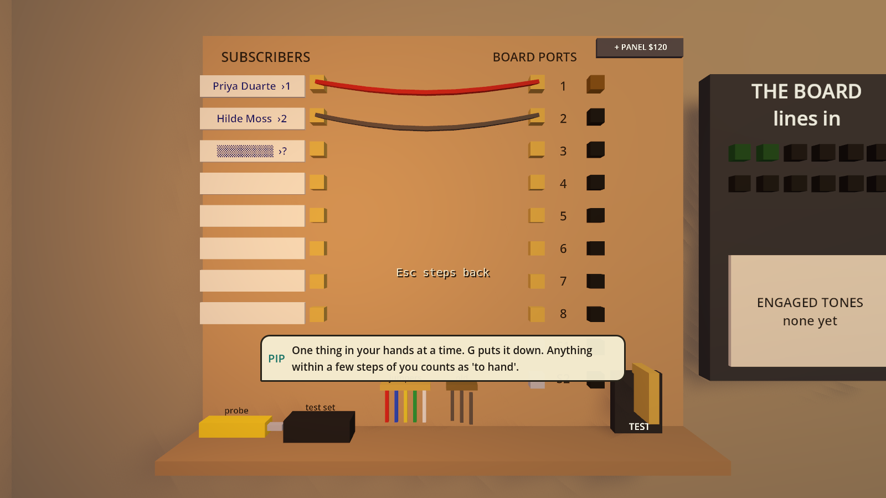
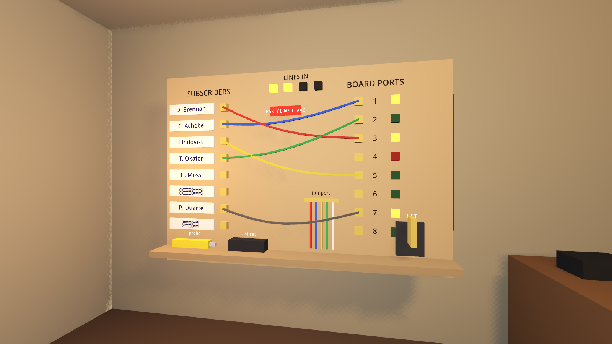

# The Desk, the Day and the Week

**Status, 2026-11-13: agreed by the owner, with changes. Decisions D23–D27 in `DECISIONS.md` are the short version.** This document started as a proposal; the owner's answers are folded in below under "What the owner changed". Section 5's questions are answered.

### What the owner changed

1. **Doors by time of day: yes,** and it points somewhere bigger: named people who really walk about the planet, who have to be home to be talked to. Lit windows and a car on the drive are the first signs of that. Later, a more detailed planet with places put down by hand.
2. **The day is timed and work is real time.** Not "each task costs so many minutes off the clock", but a day of fixed length in which a job takes as long as it takes you to do it, so only so many fit. Jobs should take *longer* for the player, with light visuals, and the objects should show mistakes, which compound.
3. **Staff have their own place and a narrow job, and are delegated to in person.** Jobs generate tickets; you give a ticket to the person. Later you buy premises; then they turn up there, and that is when they go on a wage.
4. **Switchboard first: yes.**
5. **The text strip goes;** highlights on the object and PIP explain the task as it is done.

### Built so far (2026-11-13)

- **The clock belongs to the simulation** and only real time moves it. Every hands-on step is "hold E"; a bar fills; keep holding to carry on. No clock jumps anywhere.
- **Mistakes show and compound:** a bodged stage hangs crooked for good, and several bodges on one line come to the surface sooner.
- **The next step's marker pulses;** later ones wait, small.
- **Who is home:** households out nine to five on weekdays, asleep from ten, Sol's hours, Sundays. Lit windows after dark, cars on drives. First hour exempt.
- **Tickets and Jory:** a rail of job tickets on your wall; take one, hand it to Jory Pike at your door; two a day, eight till five, Monday to Friday; paid by the job on Friday.
- **1 Main Street:** lease it and staff collect their own tickets and go on a weekly wage.
- **A wall calendar** with today, pay day, rent day, Sundays and days off, and the time.

- **The switchboard (2026-11-14).** The printed work sheet is gone. One persistent board on the wall: terminals with paper tags, ports with lamps, real jumper wires, a tone probe, a test set, clean and old jumpers on hooks, a test switch. Lean in and the mouse is your hand. Every wire stays where it was put. Live wires are people's telephones. Jory's loose jumpers are visible and can be pushed home before they become faults. The board holds 8 subscribers until a second panel ($120) makes it 16. Port lamps burn bright while that subscriber is on the Board.

### Still to build, in order

1. **The desk objects** that replace the text strip: cash tin, job spike, card index, telex roll. PIP and highlights carry the explaining.
2. **Training:** a person learns a new kind of ticket by coming along while you do three of them.
3. **Each person's own place:** Jory at a bench in the depot, Tobi at the terminal, and so on, as visible people.
4. **Appointments, night rate for the mail, tiredness (light).**
5. **Switchboard stage 2 and 3** (a proper frame at 1 Main Street; later a digital switch), and absorbing the lines-in rack into the board itself.
6. Then phase D of `EXPANSION_DESIGN.md`, built as objects.

---

---

The three ideas are one idea seen from three sides: **the game should be read off the world, not off a panel.** The time is the light outside and who has their lamp on. The plan is cards pinned to a board. The network is wires you can see.

---

## 1. The switchboard and the desk: every panel becomes an object

### The rule

1. **Every number lives on an object.** If you want to know it, you look at something.
2. **Every decision is made by moving a thing:** a wire, a card, a pin, a stamp, a switch. Not by clicking a labelled rectangle.
3. **A screen appears only where the story has a screen** (the Board's terminal, PIP's handset), and it is worked with keys, not a pointer. *(The Board's terminal, built this session, already follows this.)*
4. **Each station is upgraded over time,** and the upgrade changes how it looks and how you work it. This is the canon's "the interface is earned": paper, then terminal, then database, then dashboard.
5. **A plain list view stays available** as an accessibility option for anyone who needs it.

PIP's speech bubbles stay (the owner approved them), and so does a small prompt for the thing you are looking at.

### The switchboard (first, and the model for the rest)

Replaces the frame's printed work sheet and absorbs the "lines in" rack that sits beside it.

*A mock-up built in the game engine for this document. It is a picture, not yet a working object.*

**What is on it**

- **Left: subscribers.** One brass terminal per customer line, each with a paper name tag. Some tags are smudged.
- **Right: Board ports.** One jack per port, each with a lamp.
- **Top: lines in.** A lamp per line into the Board; empty sockets where a line card could go.
- **Shelf: your tools.** A tone probe, a test set (a lineman's handset), spare jumper wires on a hook, and a test switch.

**How you work it** (lean in; the mouse becomes your hand)

| You want to | You do | Today it is |
|---|---|---|
| Read a smudged tag | Pick up the probe, touch the terminal; the name fills in | A "Probe" button |
| Check a port is good | Hold the test set to the jack; its lamp shows green or red | A "Test port" button |
| Connect a customer | Take a jumper, click their terminal, click a port; a real wire hangs between them | Pick line, pick port, "Jumper" |
| Undo it | Pull the wire out | "Remove" |
| Cut a corner | Grab one of the old grey wires already dangling there | "Hot-wire" |
| Leave the party line alone | It is already wired, with a red tag on it | A line of text |
| Finish | Throw the test switch: lamps come on one by one; a crossed pair makes two lamps blink at each other | "Finish & test" |

The rules underneath do not change. The simulation already has exactly these actions (probe, test, jumper, remove, hot-wire, evaluate), so this is a new face on a working system, not a new system.

**It is alive when you are not using it.** At seven in the evening the port lamps flicker as people ring the Board. An engaged tone is a red flash at the top. It becomes the thing in the room you glance at.

**You can see other people's work.** When the technician wires a line, their jumper is there on the board. A sloppy one looks sloppy. That makes a new action possible: **inspecting**, finding a bad job before it becomes a fault.

**Upgrades** (bought, carried in, bolted on)

| Stage | What it is | Subscribers it holds | What changes for the player |
|---|---|---|---|
| 0 | Plywood and screw terminals (the mock-up) | 8 | Handwritten tags; everything by hand |
| 1 | A proper frame | 24 | Printed labels, fewer smudges; test jacks built in |
| 2 | A cabinet with a rack (at 1 Main Street) | 60 | Line cards slot into it; a small terminal shows which port is whose |
| 3 | A digital switch | Hundreds | The wires go behind a panel; ports are managed from a terminal; faults become software |

**A new bottleneck falls out of this for free:** a full board cannot take another customer. That is one more reason to upgrade, in the same shape as "lines in".

### The rest of the room

| Today (text on screen or a panel) | Becomes | How you read or use it |
|---|---|---|
| Date and time in the corner | **Tear-off calendar and a wall clock** | Look at them |
| Cash in the corner | **Cash tin and a bank book** | Open the tin; the book has the monthly lines |
| The "what next" line | **A spike of job slips** on the desk; later the pager | Top slip is the next job |
| Event feed | **A telex roll**, and a **newspaper on the mat** for world news | Tear off and read |
| Subscriber counts | **A card index:** one card per customer | Pull a card: satisfaction, what they have, a red tab for a fault, a blue tab for an order |
| Answering machine prompt | The machine itself: a light, a tape, **messages spoken as bubbles**, a notepad that collects them | Press play |
| The notebook's "Invest" buttons | **A card in Sol's window:** "Wanted: junior technician". An applicant comes to your door | Shake hands |
| Promise Ledger buttons | **A ledger book:** write a date beside a name | Stamp it |
| (nothing yet) | **A wall map with pins,** string between them for pole lines | Watch the network grow |
| Sol's counter: press E or R | **Goods on shelves with price tags** | Pick one up; the till rings; carry it out |
| Invoices (phase D) | **An invoice pad, a rubber stamp, envelopes** | Built physical from the start |
| Staff and jobs (section 3) | **A job board on the wall** | Pin cards to people and days |

---

## 2. The day: who is where, and what that lets you do

Today the day/night cycle is lighting. One real day is eight minutes, work moves the clock forward, and the only rule is that the evening is when people ring the Board.

**The principle: the time of day decides who is where, and that decides what you can do.** A good day has a shape you learn to plan.

| Time | The town | Good for | Not possible |
|---|---|---|---|
| **06–09 early** | People leaving for work; Sol's shut | Pole work, driving, the switchboard | Most doors; the shop |
| **09–17 working day** | Sol's open; businesses open; retired people and home-workers in; families out | Shopping, business customers, building; staff are working | Homes where everyone is out |
| **17–21 evening** | Everyone is home; the Board fills from 18:00 | Selling on the doorstep, home installs and orders, watching the Board | The shop |
| **21–23 late** | Lights going out | Desk work: files, invoices | Knocking is rude (costs goodwill) |
| **23–06 night** | Asleep; the phone company's cheap rate | The night mail call, sleeping | Going indoors; outdoor work is slow by torch |

### Proposed rules

1. **People keep hours.** Each household is home at certain times depending on who they are: Dot Brennan (retired) all day, the Lindqvists (family) evenings and weekends, Sol's and Nell Hale's business in shop hours. This replaces the dice roll for "nobody home".
2. **Lit windows tell you who is in.** You can see from the street whether it is worth knocking. No number, no icon.
3. **Appointments.** An install or an order comes with a day and a time that suits them ("Thursday evening"). Turn up then and they are in.
4. **Sol keeps shop hours,** and is closed on Sundays. Running out of modems on a Saturday night matters.
5. **The evening is a real choice.** It is the best time to sell and the time the Board most needs watching. You cannot do both, which is the reason to hire a co-sysop.
6. **Night rate.** The mail call costs half after 23:00. So you stay up, or Tobi does, or (later) a timer does it. That gives one job all three stages the game is about: by hand, handed over, automatic.
7. **Faults are found in the evening,** when people sit down to use the line. The phone rings then.
8. **Staff work 8 to 5, Monday to Friday.** An evening fault waits for morning unless you go yourself or pay overtime.
9. **Weekends.** Families are home all day (the best selling days); Sol is shut on Sunday; staff are off.
10. **Tiredness, lightly.** After about 18 hours awake, jobs take a quarter longer until you sleep. It nudges you to bed without ever stopping you.
11. **Dark.** Outdoor work at night is slower by torchlight.

**Customers feel the day too:** they are annoyed by a knock at ten at night, pleased by an appointment kept, and they ring the Board according to their own habits (the gamer late, the family early), which the simulation already does.

**What stays the same:** eight minutes to a day; sleeping skips to the next thing that needs you, so quiet weeks still pass quickly.

**The risk:** "nobody's in during the day" could feel like a wall. It is softened three ways: about a third of the town is always in; appointments make it plannable; and daytime has its own work (building, the shop, businesses).

---

## 3. The week: a calendar you fill, staff you train

Today the technician quietly connects one waiting customer a day. You never see a plan and cannot change it.

### The job board

A cork board on the wall. **Columns are days** (this week and next). **Rows are people:** you, then each person you have hired. **Jobs are paper cards**, coloured by kind: install, order, repair, pole work, odd job, desk chore.

- A card shows who it is for, how long it takes, what kit it needs and when they are home.
- New jobs land in an **in-tray**. You pick up a card and pin it to a person and a day.
- Each morning people take their day's cards and go. Travel time from the depot counts, so far-away jobs fit fewer to a day.
- **You are a row too.** Your own day fills up; the spike on your desk is just your row for today.
- **If you ignore the board it still works:** each person takes the oldest card they are able to do. Planning is an advantage, never a chore you are punished for skipping.

### Trained staff

Each person has **tickets**: the kinds of work they are trained for. A card can only be pinned on someone with the right ticket.

| Ticket | Covers |
|---|---|
| **Installs** | House installs, line cards |
| **Bench** | Repairs, odd jobs, catalogue orders |
| **Lines** | Poles, spans, climbing |
| *(later)* Switchboard, Board, Books, Driving, Rigging | |

**Training is doing the job together.** Pin a card on yourself *and* a trainee. You do it by hand; they come along. After three shared jobs they earn the ticket. Their accuracy rises with experience: about 80% when new, 90% practised, 95% old hand.

This is why hands-on work never goes away: later in the game you do a job by hand because you are teaching someone, not because nobody else can.

- Wages rise with tickets held.
- The first hire arrives with one ticket (Installs), exactly as now.

### Handing over the calendar itself

Later you hire a dispatcher, and after that buy dispatch software. They fill the board for you, sensibly most of the time. The board on the wall becomes a terminal, then a dashboard. The calendar is one more job that goes from by-hand to handed-over to automatic.

---

## 4. Build order

Each step ends playable. "Session" means one working session like those so far.

| # | Step | Sessions | Why here |
|---|---|---|---|
| 1 | **Switchboard, stage 0:** working wires, probe, test set, lamps; replaces the work sheet; absorbs the lines-in rack | 2 | The owner's own example; the most-used panel; no rule changes needed |
| 2 | **The desk:** calendar and clock, cash tin, job spike, card index (removes most of the on-screen text) | 2 | Finishes "read it off the world" for the room |
| 3 | **The day:** who is home, lit windows, shop hours, appointments, night rate | 2 | Needs the calendar object from step 2 |
| 4 | **Phase D of the expansion plan,** built physical: invoice pad and stamp, late payers, mixed phone messages, bookkeeper and receptionist | 2 | Was already next; now built the new way |
| 5 | **The job board, tickets and training** | 3 | Replaces "crews and work orders" in the expansion plan |
| 6 | **Sol's counter, hiring cards, the wall map, the ledger book** | 2 | Clears out the last panels |
| 7 | **Switchboard stage 1,** and capacity as a bottleneck | 1 | With the move to 1 Main Street |

About 14 sessions. This slots in before the fishing village (phase F onward in `EXPANSION_DESIGN.md`), which then gets built with all of it in place.

---

## 5. Questions for the owner (answered 2026-11-13: see the top of this document)

| # | Question | Recommendation |
|---|---|---|
| Q1 | Is it right that many doors only open in the evening, with about a third of the town always in and appointments to plan around? | Yes |
| Q2 | Tiredness: a light version (jobs take longer after 18 hours awake), or leave it out? | Light version |
| Q3 | Staff tickets: start with three (Installs, Bench, Lines), earned by doing three jobs together with you? | Yes |
| Q4 | Switchboard first, fully replacing the work sheet (with a list view kept as an accessibility option), and a full board as a new bottleneck? | Yes |
| Q5 | Should the on-screen text strip go entirely once the desk objects exist, or stay as an option? | Off by default, option to turn it on |
